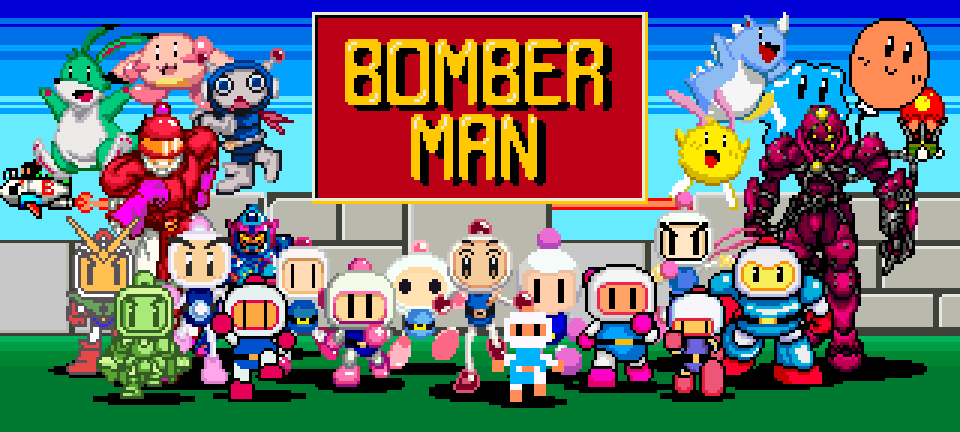
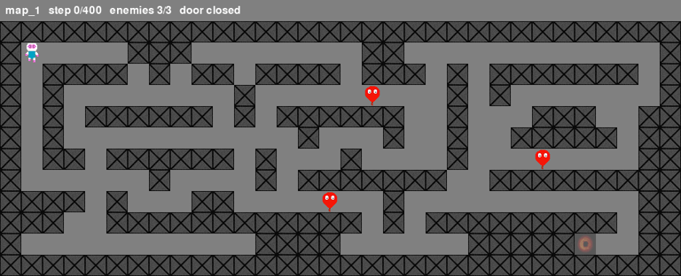

<p align="center">
  
</p>

# smart-bomberman [](https://github.com/sandeep-selvaraj/smart-bomberman/actions/workflows/pylint.yml) [](https://github.com/sandeep-selvaraj/smart-bomberman/actions/workflows/mypy.yml)
<a href="https://github.com/sandeep-selvaraj/smart-bomberman/blob/master/LICENSE">
  
</a>
<a href="https://tu-dresden.de/?set_language=en">
  
</a>

<a href="https://imld.de/en/">
  
</a>

### Visual Computing Team Project 2023

[](https://discord.gg/CpHsfRzCk)

Released under [MIT](/LICENSE). 

## Table of contents

- [Installation](#installation-of-package)
- [Run the game](#to-start-the-game)
- [How to play the game](#game-controls)
- [AI agent (2026 revival)](#ai-agent-2026-revival)
- [Information of the AI agents](#information-of-the-ai-agents-2023)
- [Note on problems](#note-to-keep-in-mind-for-untracked-or-potenital-issues)
- [Documentation](#documentation)

### Installation of package
The project uses [uv](https://docs.astral.sh/uv/). It installs the right Python (3.11 by default, 3.10+ supported)
and the exact dependency versions from `uv.lock`:

```bash
uv sync
```


### To start the game

run `uv run smart-bomberman play` in your terminal

### Game controls
- Arrow keys to move
- 'X' to place bomb


### AI agent (2026 revival)

<p align="center">
  
</p>

The `ai/clean-agent` branch picks up `feature/juhyun` and makes the agent actually train.
The original setup could not learn: the game only advanced inside `render()`,
bomb fuses ran on wall-clock time, and one tile of movement took 16-32 actions.
`src/game/ai/` now holds a headless, tile-based engine with the same rules
and a Gymnasium env. A PPO agent trained on it wins:

| Map | Win rate (deterministic, 200 episodes) | Random policy |
|---|---|---|
| map_1 (maze, 3 enemies) | **91%** | 0% |
| map_2 (open grid, 3 enemies) | **79.5%** | 0% |

```bash
uv sync
uv run smart-bomberman watch models/ppo_map1_map2.zip --maps map_1 --deterministic   # watch the trained agent
uv run smart-bomberman evaluate models/ppo_map1_map2.zip --maps map_2 --episodes 200 --deterministic
uv run smart-bomberman train --maps map_2 --timesteps 1000000    # about 7 minutes on a laptop CPU
```

See [docs/EXPERIMENTS.md](docs/EXPERIMENTS.md) for what was wrong, what changed, and the
results of each round of trials. Tests and linters: `uv run pytest`, `uv run pylint src tests`, `uv run mypy src`.

### Information of the AI agents (2023)
### Following branches can be explored for the different AI agents built for this team project

- _feature/divyendu_ : Multiple observation space related PPO and NEAT models that fuel the AI agent
- _feature/ken_ : Multiple Observation spaces PPO with curriculum learning path taken
- _feature_juhyun_ : Dict Observation space and best working model for AI agent
- _feature/sandeep_ : Box Observation space - "Redundant and maybe be improved"
- _training/sandeep_ : Multiplayer for visual benchmarking and visualization of training processes

### Note to keep in mind for untracked or potenital issues

- **PyTorch builds**: on Linux and Windows, `pyproject.toml` installs the CPU-only PyTorch wheels
(PyPI's default ones bundle several GB of CUDA). The agents here train fine on a CPU. To train on an
NVIDIA GPU, change the `pytorch-cpu` index URL in `pyproject.toml` to a CUDA one from
[pytorch.org](https://pytorch.org/get-started/locally/) (e.g. `https://download.pytorch.org/whl/cu126`) and run `uv lock && uv sync`.
On macOS the default wheels are used.
- Follow the requisite instructions for each branch and be careful with `gymnasium` and `stable-baselines` libraries. 

### Documentation

Please check out the [official documentation](https://cloudstore.zih.tu-dresden.de/index.php/s/f5Dr3pppn6ySrcp) 
pertaining all the key aspects of research and development of the smart-bomberman.